<div align="center">



<br>


### Comentou, aconteceu.

Jogos interativos para **TikTok LIVE**: cada comentário e presente da audiência vira ação dentro do jogo, ao vivo, na tela do streamer.

<br>


</div>

---

## O que é

O **GameLive** é um conjunto de jogos feitos para rodar *durante* uma live. O streamer abre o jogo, informa o seu `@` uma vez, e a partir daí quem joga é o chat:

- 💬 **comentário vira jogada** — escolher um time, entrar na corrida, soltar uma pipa;
- 🎁 **presente vira evento** — voto, nitro, bola de demolição, golpe especial;
- 👀 **quem assiste se vê na tela** — nome e foto de quem participou aparecem no jogo.

## Como funciona

```
 TikTok LIVE ──► ponte (Node.js) ──WebSocket──► jogo (página HTML5) ──► OBS / LIVE Studio
   comentários     padroniza os eventos             reage aos eventos       captura a tela
   presentes       conta presentes em sequência
```

| Parte | Onde | O que faz |
|---|---|---|
| **Ponte** | `ponte/` | Conecta na live pelo `@`, converte comentários e presentes num formato único, conta presentes em sequência sem duplicar e reconecta sozinha se a live cair. |
| **Simulador** | `ponte/simulador.js` | Gera comentários e presentes falsos para testar e gravar demonstrações sem estar ao vivo. |
| **Kit** | `jogos/kit/` | Base comum dos jogos: conexão com a ponte, palco 9:16, avisos, placar salvo, times. |
| **Jogos** | `jogos/<nome>/` | Cada jogo é uma página estática com um `config.json` editável. |

## Jogos

| Jogo | Como o chat joga | Status |
|---|---|---|
| 🗳️ **Urna da Live** | Cada presente vira voto para um dos dois lados da barra | em desenvolvimento |
| 🪢 **Cabo de Guerra** | Comente o seu time e puxe a corda; presente puxa mais forte | em desenvolvimento |
| 🏎️ **Corrida do Chat** | Quem comenta entra na pista; presentes viram nitro e óleo | em desenvolvimento |
| 🗼 **Torre Alta** | Presentes constroem e derrubam a torre | em desenvolvimento |
| 🏰 **Torres Rivais** | Dois times, duas torres, quem chega primeiro na meta | em desenvolvimento |
| 🐦 **Voo da Live** | O pássaro voa sozinho e o chat tenta derrubar | em desenvolvimento |
| 🪁 **Céu de Pipas** | Cada comentário é uma pipa; presente corta a linha do rival | em desenvolvimento |
| 🥊 **Briga da Live** | Escolha o lutador; presentes viram golpes | em desenvolvimento |

## Começando

Requer **Node.js 20+**.

```bash
npm install

# testar sem live (eventos falsos)
npm run simular

# conectar numa live de verdade
npm start -- @seu_usuario
```

Depois abra **http://localhost:3000/jogos/**, escolha um jogo e capture a página:

- **OBS:** fonte *Navegador* → URL do jogo, largura `1080`, altura `1920`.
- **TikTok LIVE Studio:** captura de *Janela* do navegador com o jogo aberto.

Em todo jogo, a tecla `T` dispara um evento de teste.

### Configurando os presentes

Cada jogo tem um `config.json` com nomes, cores e quais presentes fazem o quê. Um presente pode ser indicado pelo **ID** (número) ou pelo **nome**:

```json
{ "presente": 5655, "votos": 1 }
{ "presente": "Rose", "votos": 1 }
```

Para descobrir o ID dos presentes da sua região, conecte numa live e abra o arquivo `presentes-vistos.json`, que a ponte preenche com todo presente que chegar.

Se a conexão começar a falhar por limite, crie uma chave em [eulerstream.com](https://www.eulerstream.com) e rode com `EULER_API_KEY=sua_chave`.

## Testes

```bash
npm test
```

## Avisos

- O TikTok **não tem API oficial** para eventos de live. A ponte usa a biblioteca comunitária [`tiktok-live-connector`](https://github.com/zerodytrash/TikTok-Live-Connector), que pode parar de funcionar quando o TikTok mudar algo.
- Temas políticos em lives com presentes podem violar as regras de monetização do TikTok e, em período eleitoral, a vedação a enquetes do TSE. Os lados de cada jogo são configuráveis justamente para que essa escolha seja do streamer.
- GameLive não tem vínculo com TikTok, OBS ou qualquer outra marca citada.

<div align="center">
<br>
<br>
<sub>feito para lives que querem a audiência jogando junto</sub>
</div>
